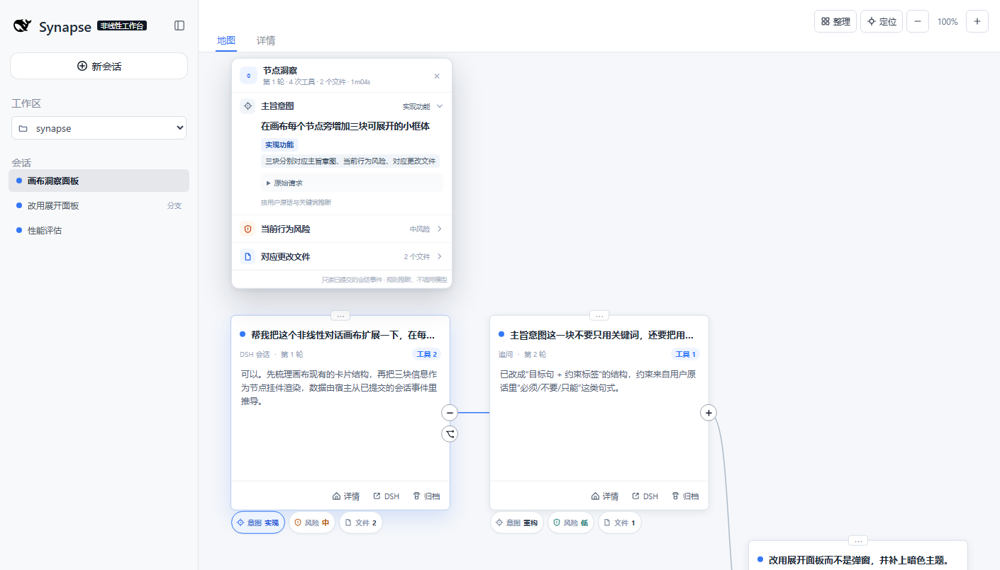
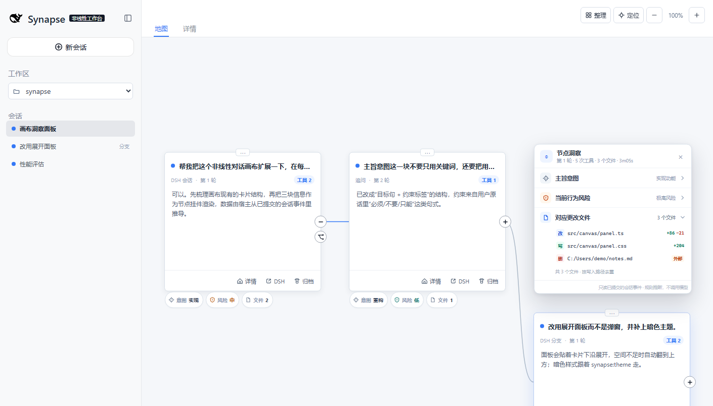
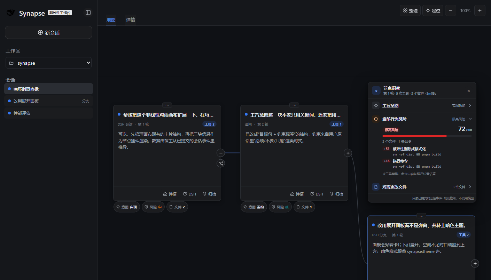
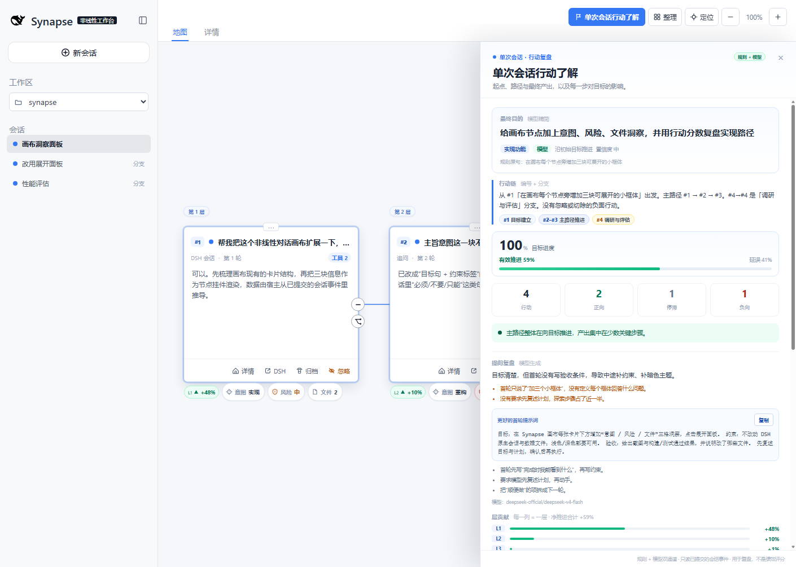
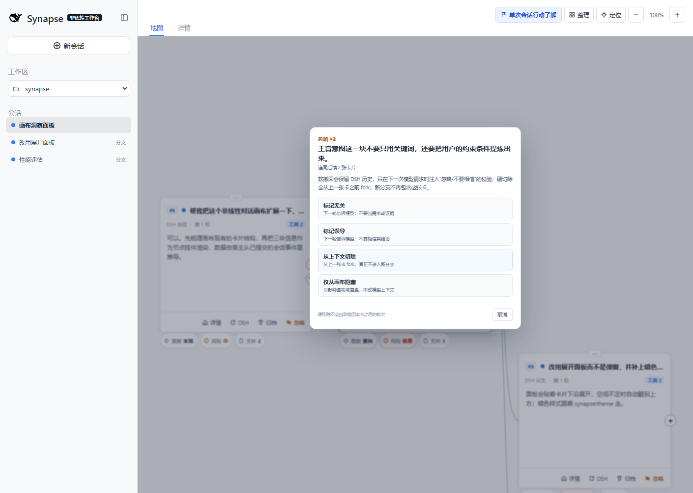
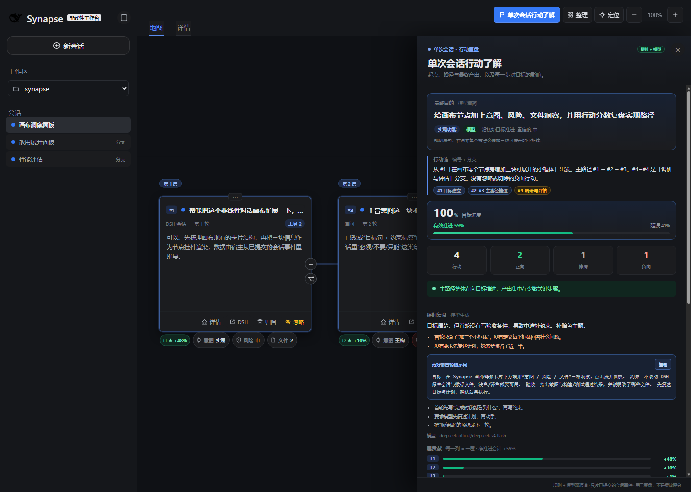

<h1 align="center">dsh-synapse-lens</h1>

<p align="center">在非线性对话画布上，为每个节点装一扇「洞察」小窗</p>

<p align="center">
  
  
  
  
</p>

<p align="center">
  <a href="docs/zh-CN/README.md">上游中文指南</a> ·
  <a href="docs/en/README.md">Upstream English guide</a> ·
  <a href="docs/architecture.md">架构与边界</a> ·
  <a href="docs/development.md">开发与发布</a>
</p>

`dsh-synapse-lens` 是 [dsh-synapse](https://github.com/liangmianya/dsh-synapse) 的一个 MIT 分支：保留「把会话摊成一张可拖拽、可缩放地图」的全部能力，并在每张对话卡片下方增加一条**节点洞察栏**。



## 这个分支加了什么

每张画布卡片下方都有三格小胶囊，分别对应：

| 小框体 | 回答的问题 | 一眼能看到 |
|---|---|---|
| **主旨意图** | 这一轮用户到底想达成什么？有哪些约束？ | 意图类型 + 目标短句 + 约束标签 |
| **当前行为风险** | 这一轮助手做了什么、风险有多高？ | 低/中/高/极高 + 0–100 分 + 具体原因 |
| **对应更改文件** | 这一轮动了哪些文件、改了多少？ | 文件路径 + 写/改/删 + 增删行数 + 工作区外标记 |

点任意一格，会在卡片旁展开一个可滚动的**小面板**：同一面板里三段可折叠，打开哪一格就展开哪一段；再点一次、按 `Esc` 或点面板外即收起。面板空间不足时自动翻到卡片上方，靠近画布边缘时会平移画布保证完整可见。



深色主题跟随 DSH 的 `synapse:theme`：



## 数据从哪里来

宿主端（`index.js` + `insight.js`）只读取 **DSH 已经提交的会话事件**，按用户消息切轮，解析该轮里的 `tool/call` 参数，然后用确定性规则得出三块信息：

- **意图**：按用户原话抽取目标句、意图类型（实现 / 修复 / 重构 / 分析 / 文档 / 测试 / 配置 / 设计 / 审查）和「必须、不要、只能」这类约束；不把整段对话再喂给模型。
- **风险**：按工具类型（文件写入、Shell、补丁、网络、子代理）、命令内容（破坏性删除、远程脚本、强推、提权、装依赖、改写 Git 历史……）、路径位置（工作区外写入）和本轮是否失败累计分数。分数是**提示**，不是审批结论。
- **更改文件**：从 `write` / `edit` / `apply_patch` 等工具参数取路径与增删行数；`apply_patch` 解析 `*** Add/Update/Delete File:`；Shell 里能明确识别的 `Set-Content`、`Out-File`、重定向、`Remove-Item` 等标记为「命令推断」。同一路径去重并合并。

节点洞察面板刻意**不调用模型**：面板底部标明「只读已提交的会话事件 · 规则推断」。单次会话复盘则不同——它会在规则层之外，额外调用一次 DSH 当前默认模型做精简与打分（下文详述）。

## 单次会话行动了解

画布顶部新增一个按钮 **「单次会话行动了解」**。点开后，它把当前会话树（当前分支所在的根会话 + 它下面的所有 fork）当成一次完整的实现过程来复盘：

1. **最终目的**：规则层先以第一条真实用户消息为主，模型层再压缩成一句更短的目标；规则原句保留在下方对照。
2. **行动链**：用卡片编号串起主路径和侧分支，例如 `#1 目标建立 → #2–#3 部署与可用性 → #4–#6 个性化优化`。
3. **路径（起点 → 最终产出）**：沿当前分支走到最后一张卡片，逐步列出问题、这一步对目标的“影响百分比”和原因。
4. **侧分支**：主路径之外的追问/fork 单独成条，例如“安装好了吗 → 打不开 dsh”的部署验证分支。
5. **最终产出**：最后一条回答、累计改动文件和失败状态。
6. **提问复盘**：现在放在报告靠前的位置，直接指出哪些提问习惯让路径变长、轮次变多，并给出一段可复制的高质量首轮提示词。



### 卡片编号

每张卡片在创建后自动获得 `#N` 编号，按整棵会话树的创建时间排序，显示在卡片标题左侧、路径圆圈和报告的行动链里。忽略/切除卡片**不会重排已有编号**：`#2` 被忽略后，后续仍是 `#3`、`#4`，保留一个空号，和 Git 提交号一样可追溯。

### 卡片下方的进度三角

一次完成会话的目标进度按 **100%** 计，每张卡片显示它在这 100% 里的份额：

- **绿色 ▲ +X%**：这一步推进了目标，所有正向卡片加起来正好 100%。
- **红色 ▼ −Y%**：这一步造成返工/延误，Y 按“有效动作总量”折算；会话的有效推进 = 100 − 延误。
- **灰色 • 0%**：停滞，没有形成可辨识的推进。

例如报告头部的 `目标进度 100% · 有效推进 59% · 延误 41%`，表示目标最终达成，但路径里有 41% 的动作是返工或绕路。卡片上的三角只在**复盘打开时**出现，不会污染日常画布。

### 层 = 画布的一列

地图的每一列现在被当作一层：卡片上标 `L1 / L2 / L3`，复盘打开时画布上方会出现「第 1 层 / 第 2 层」标签，报告里也有「层贡献」逐层百分比。层号按会话树的因果深度计算：起点是 L1，每次追问或 fork 进入下一层。这样能直观看到“哪一层真正产生了推进，哪一层只是在原地打转”。

### 规则 + 模型双层驱动

- **规则层**始终运行：文件改动、探索、收束、风险、失败、下一轮修正等信号给出 `-100 ~ +100` 的原始分。
- **模型层**在复盘接口里调用 DSH 当前默认模型，要求它：
  - 把最终目的压缩到 30 字以内；
  - 给每一步一个 `-100 ~ +100` 的影响分和一句理由；
  - 写“提问复盘”：问题清单 + 更好的首轮提示词 + 下次提问原则。
- 最终分 = **45% 规则 + 55% 模型**；百分比份额在合并后重新归一化，规则分和模型分都保留在报告里对照。
- 模型不可用（未配置默认模型、接口超时、登录失效、JSON 不合法）时，自动退回**仅规则**报告，并在“提问复盘”下方说明原因；不会让复盘失败。

### 规则层怎么打分

分数范围 `-100 ~ +100`，**≥ +15 为正向，≤ −15 为负向，其余为停滞**：

| 信号 | 原始分 |
|---|---|
| 这一步改动了文件 | `+25` 起，文件越多略增 |
| 只读探索、为后续铺垫 | `+4` |
| 最后一步收束并给出产出 | `+12` |
| 第一步确立目标 | `+5` |
| 出现极高 / 高风险动作 | `−15 / −6`（提示风险，但不抵消同一步产出） |
| 这一轮没有完成 | `−35` |
| 下一轮用户说“不对 / 改成 / 回退…” | `−20` |

分支分是该分支所有步骤的均值；正向份额再按权重分到 100%。它是**复盘提示**，不是绩效评分：同一段行为换一个目标，分数含义就会变。

### 提问复盘：双边 harness

报告最后一部分把“提问者”也当作需要约束的一方：

- 指出首轮是否缺少验收条件、是否把多个目标塞进一句话、是否用“顺便/然后”制造额外路径；
- 基于目标与约束生成一段更高质量的首轮提示词，含“先复述计划再执行”的要求，可一键复制；
- 给出 2–3 条下次提问原则，目标是**减少提问轮次和绕路**，而不只是把这次任务做完。

## 忽略 / 切除卡片

每张卡片底部都有 **忽略**。它不是一个笼统的“删除”，而是三个明确语义：

### 软撤回（推荐）

- **标记无关**：下一轮告诉模型“不要把它的提问/回答当作需求或证据”。
- **标记误导**：下一轮告诉模型“不要相信它的结论，它可能把你带偏”。

软撤回会隐藏该卡片及其后续子树，并从复盘与模型评审中剔除；同时通过 DSH 的动态上下文，在**下一次模型请求**里追加一条 sourced context 校验：

```text
[Synapse 上下文校验]
用户已将以下早期卡片标记为无效……
- #2「安装好了吗」：与任务无关，不要把它当作需求、事实、证据或约束。
不要基于这些卡片继续推断或实现；如果当前请求依赖它们，先向用户确认。
```

它保留 DSH 原始历史，不减少 token，也不改写会话日志；只改变模型对这段历史的解释。作用范围是该会话及其 fork 子会话。12 秒内可从画布底部恢复，之后可在复盘的“已忽略 / 切除”区点“恢复已忽略”。

### 硬切除

从**这张卡片之前的一张卡**（上一轮回答）fork 一个新分支，并切换到新分支：

- 被切除的卡片及其后续轮次**不会进入**新会话的上下文；
- 这是真正的物理去除，但本卡之后的轮次也不会自动带过去，需要在新分支重新提问；
- 原会话仍保留在 DSH 中，便于对照，但不会再按旧路径继续；
- 硬切除没有“恢复原上下文”按钮，因为它已经创建了新会话；如需回到旧路径，请手动打开原会话。

### 仅从画布隐藏

只从画布与复盘剔除，不改模型上下文。用于“我不想在地图里看到它，但暂时不影响对话”。

所有方式都会把卡片及其子树作为负向行动计入复盘（每张 8%，上限 50%），并保留编号空号。**DSH 原始会话记录不会被改写。**



深色主题同样适配：



## 安装

前提：DSH `>= 0.1.7-rc.2`（本分支在 `0.2.1-rc.5` 上开发验证）和 Node.js `>= 22.19.0`。

先确认要装进哪套 profile：

| 你平时怎么用 DSH | profile | 命令 |
|---|---|---|
| 桌面 App | `desktop` | `dsh plugin --profile desktop add "link:C:/path/to/dsh-synapse-lens"` |
| `dsh web` / 浏览器 | `web` | `dsh plugin --profile web add link:C:\path\to\dsh-synapse-lens` |

```powershell
# 本机 checkout 安装（改代码即时生效）
dsh plugin --profile desktop add "link:C:/path/to/dsh-synapse-lens"

# 命令行形态
dsh plugin --profile web add link:C:\path\to\dsh-synapse-lens
dsh web
```

装完**重启桌面 App**，或在命令行重启 `dsh web` 并刷新页面；顶部出现「会话地图」即安装成功。

> 更新本分支源码后同理：Host 侧的洞察与复盘接口只在 App / `dsh web` 启动时注册。只刷新页面会更新前端按钮，但点复盘会提示“接口还没有加载”，重启一次即可。

> [!IMPORTANT]
> 本分支沿用上游的服务名 `synapse` 和路由 `/synapse`，与 `dsh-synapse` **不能装在同一个 profile**。先卸载原插件：
> `dsh plugin --profile desktop remove dsh-synapse`。
>
> 画布数据路径不变（`$DSH_HOME/synapse/workspaces.json`），卸载/重装不会丢会话，旧画布布局可以直接沿用。

### 装到另一台电脑

**方式 A：tarball（推荐，不用带源码目录）**

把本仓库根目录的 `dsh-synapse-lens-0.10.0.tgz` 复制到新电脑，然后：

```powershell
# 1. 先完全退出桌面 App（避免 profile 被锁）
# 2. 如果装过上游 dsh-synapse，先移除（同一服务名，不能共存）
dsh plugin --profile desktop remove dsh-synapse

# 3. 从 tarball 安装
dsh plugin --profile desktop add "file:C:/Users/<你>/Downloads/dsh-synapse-lens-0.10.0.tgz"

# 4. 重新打开桌面 App
```

`dsh web` 用户把 `--profile desktop` 换成 `--profile web`，然后重启 `dsh web` 并刷新页面。

**方式 B：复制源码目录（适合继续改代码）**

复制整个 `dsh-synapse-lens` 文件夹（不要带 `node_modules`，本项目没有运行时依赖），然后：

```powershell
dsh plugin --profile desktop add "link:C:/path/to/dsh-synapse-lens"
```

**新电脑需要**：DSH `>= 0.1.7-rc.2`（建议 `0.2.1-rc.5+`，软撤回/硬切除依赖新版 `systemPrompt.context` 与 `sessions.fork`）。桌面 App 自带 Node 运行时；只有从源码跑 `dsh web` 才需要 Node.js `>= 22.19.0`。

**画布数据**：新电脑默认从空画布开始。要带走布局，复制 `%USERPROFILE%\.dsh\synapse\workspaces.json`；但卡片关联的是旧电脑的 DSH 会话 ID，若没有同时迁移 `%USERPROFILE%\.dsh\sessions`，卡片可能只能作为历史预览，不能继续对话。**不要**为了装插件复制 `.credentials.yaml`。

**验证**：重启后打开任意会话，顶部出现「会话地图」；点卡片底部「忽略」能看到软撤回/硬切除菜单。

## 使用

1. 在 DSH 里选择工作目录或打开会话，点顶部「会话地图」进入画布。
2. 找到任意卡片，看卡片下方三格：`意图 实现`、`风险 中`、`文件 3`。
3. 点任意一格展开节点洞察面板；三段可切换：
   - 主旨意图里可展开「原始请求」看用户原话；
   - 风险段列出评分原因和工具构成；
   - 文件段按路径去重，`写 / 改 / 删` 标记，工作区外路径会标「外部」。
4. 关闭：再点同一格、右上角 `×`、按 `Esc`，或点面板外。
5. 想复盘时点顶部 **「单次会话行动了解」**：先看最终目的、行动链和层贡献，再读靠前的“提问复盘”并复制更好的首轮提示词，最后沿路径看每一步的 `+X% / −Y%`；点任意一步可定位到画布卡片。

卡片、分支、同步、归档、详情侧栏等上游能力保持不变。

## 与上游的关系

- 代码基线：`dsh-synapse` `0.5.6`（MIT），保留其 `LICENSE` 与文档。
- 包名、展示名换成了 `dsh-synapse-lens`；服务 id 与 `/synapse` 路由保持不变，便于继承旧画布数据。
- 新增 `insight.js`（节点洞察规则）、`retrospective.js`（复盘规则、层/百分比/编号/合并）、`llm-review.js`（可选模型复盘），以及 `GET /synapse/api/threads/:id/insights`、`GET /synapse/api/threads/:id/retrospective`、`POST /synapse/api/threads/:id/cards/delete`、`POST /synapse/api/threads/:id/cards/restore`。
- 卡片忽略/切除记录保存在 workspace 的 `deletedCards` 中（rootCardId、threadId、cardIds、卡片编号/摘要、`mode`、`reason`、时间），不写 DSH 会话；`mode: 'soft'` 会通过 `ctx.inject(['systemPrompt'])` 注册 `synapse:retracted-cards` 动态上下文，在下一轮模型请求中追加“忽略/不要相信”的校验。旧数据加载时自动补齐为 `mode: 'hide'`，不会突然影响模型。
- 另外修了三个上游细节：
  - 卡片 footer 的「详情 / DSH / 归档」和右侧折叠/分支按钮共享 `data-thread`，复用渲染时会被 DOM morph 合并成一个按钮；本分支给这些按钮补了唯一的 `data-morph-key`。
  - `time-context` / `tool-jobs` 这类 Harness 注入的 `user/message` 不再被当成用户轮次，否则真实请求的工具会挂到一条「Time sampled…」提示上，请求本身的卡片反而显示没有行为。
  - `client.js` 的 `__ModuleLoader__` 注册 id 必须与包名一致（`dsh-synapse-lens`）。沿用上游的 `dsh-synapse` 会让 DSH 客户端模块加载器认为 bundle 没有注册成功、再执行一次并抛出 `duplicate factory registration`，最终触发启动恢复模式。

## 边界与已知限制

- **只分析已提交的轮次**：正在生成或刚结束还没写日志的轮次，三格显示「待」，回复结束后重新打开即可。
- **文件列表依赖工具参数**：v5 画布数据不保存工具参数，宿主会重新读该会话的日志；归档或日志已不可用的会话会退化为「仅能从预览推断」，此时文件列表为空。
- **Shell 写入是启发式**：只识别常见写法，任意脚本、管道和变量拼接无法覆盖；不确定时宁可不报。
- **风险分是提示**：规则基于工具名、命令文本和路径前缀，不代表真实安全评估，也不替代 DSH 的审批。
- **面板随画布缩放**：它是画布内容的一部分，缩放后字号一起变小；需要看清时可放大画布。
- **复盘范围是当前会话树**：只包含当前分支所在的根会话及其 fork；未挂到同一根的其他会话不会混入。
- **影响分是启发式**：规则层看文件改动、风险、失败、修正语句和收束位置；模型层也可能判断偏差。同一行为换一个目标，分数含义会变。主路径默认沿当前分支的最后一张卡片回溯。
- **层按因果深度计算**：默认与画布列一致；手动把卡片拖到别的列后，`L` 标签仍按真实追问/fork 深度，不按视觉坐标。
- **软撤回不是物理删除**：它保留 DSH 历史，在下一轮模型请求里追加校验；不减少 token，也不能保证模型 100% 不再受其影响。它作用于该会话及其 fork 子会话，且对正在生成的当前轮无效。
- **硬切除才是物理移出上下文**：从上一张卡的答案处 fork，新分支不包含被切除的卡片及之后轮次；代价是后续轮次需要重新问。原会话仍保留，不能在 Synapse 里“撤销 fork”。
- **隐藏、软撤回、硬切除都会按每张 8%（上限 50%）计入复盘延误**；`mode: 'hide'` 不改变模型上下文。
- **忽略/切除后的编号保留空号**：`#2` 被忽略后后续仍是 `#3/#4`；恢复后编号不变。编号按会话树创建时间计算，不因拖拽改变。
- **模型层会产生一次模型调用**：使用 DSH 当前默认模型，可能消耗 token；结果按线程缓存 30 秒。未配置模型、超时或返回不合法时自动退回仅规则报告。复盘会把目标、步骤问题、文件路径和最终回答摘要发给该模型，不发送完整文件内容。
- 要关闭模型层，在 profile 的 `cordis.patch.yml` 里覆盖 `llmReview: false`；要指定模型，可加 `llm: { provider, model }`。
- 只支持 `web` profile 组合（桌面 App 的 `desktop` 也包含 Web 组合）。

## 开发

```powershell
corepack pnpm install --frozen-lockfile
corepack pnpm run build
corepack pnpm test
```

无 DSH 环境下看界面：

```powershell
node dev/mock-server.mjs 6123
# 打开 http://127.0.0.1:6123/synapse/?open=t1:1:intent
# 深色：&theme=dark；文件段：&open=t2:6:files
# 复盘：&retro=1；滚到底：&retro=1&scroll=end；深色复盘：&retro=1&theme=dark
# 复盘夹具含一次模拟模型评审（规则 + 模型双层），不会真的请求模型
```

`dev/` 下另有 `cdp-inspect.mjs` / `cdp-eval.mjs` / `check-client.mjs`，用本机 Edge 的 DevTools 协议截图、检查 DOM，或验证客户端插件能否在一个真实 DSH Web 页面里完成 boot；它们只用于开发，不随包发布。

## 许可证与致谢

[MIT](LICENSE)。上游项目：[liangmianya/dsh-synapse](https://github.com/liangmianya/dsh-synapse)。本分支的面板设计、规则引擎与文档由本次开发新增；上游的会话投影、画布、分支与同步逻辑原样保留。
